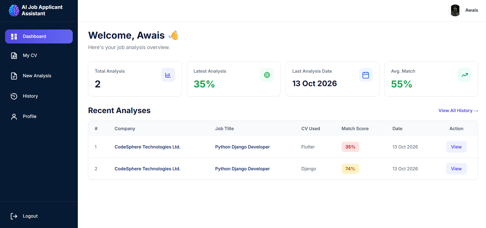
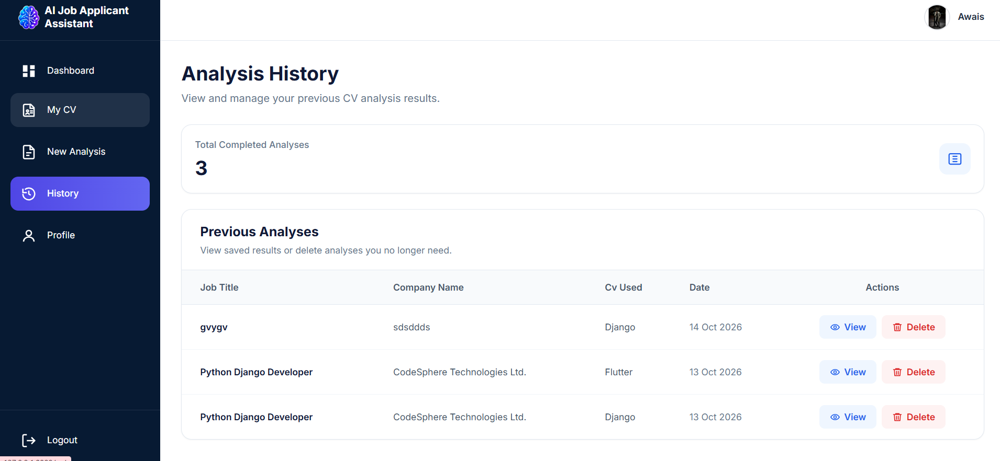
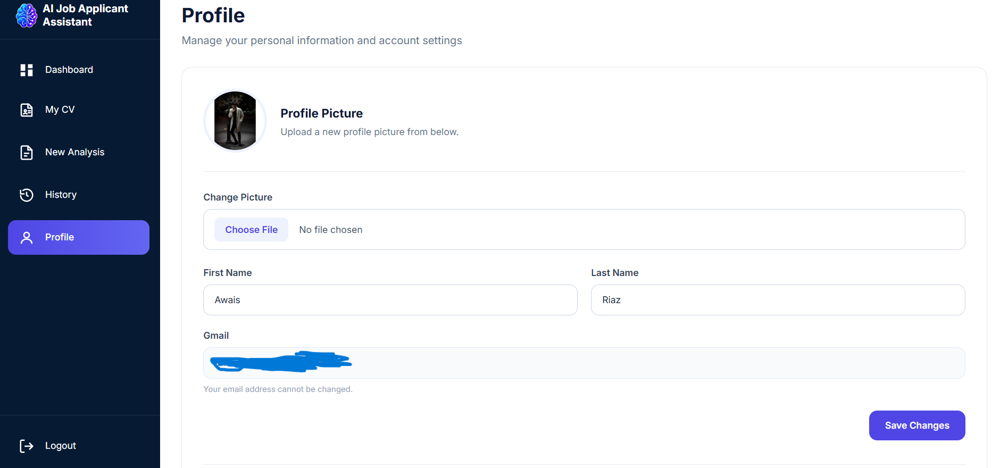

# AI Job Application Assistant

### AI-Powered Resume Analysis & Job Description Matching

**A full-stack Django web application that helps job seekers evaluate their CVs against job descriptions, identify missing skills, and receive actionable recommendations to improve their job applications.**

Built using **Python, Django, MySQL, Machine Learning, and Tailwind CSS**, this project demonstrates full-stack development, database management, user authentication, document processing, and AI-powered analysis.

---

## Overview

Applying for jobs can be challenging when candidates are unsure how well their CV matches the employer's requirements.

**AI Job Application Assistant** addresses this problem by allowing users to upload their CV, enter a job description, and receive a detailed compatibility analysis.

The system provides:

- An overall CV-to-job match percentage
- Identification of matching and missing skills
- Recommendations for improving CV alignment
- Saved analysis results for future reference
- A personalized dashboard to track analysis activity

The goal is to make the CV evaluation process simpler, faster, and more informative.

---

## Technology Stack

| Category | Technologies |
|---|---|
| Backend | Python, Django |
| Frontend | HTML5, CSS3, JavaScript |
| UI Framework | Tailwind CSS |
| Database | MySQL |
| AI / ML | Python-based CV and job description analysis |
| Authentication | Django Authentication |
| Database ORM | Django ORM |
| Version Control | Git & GitHub |

---

## Application Preview

### Landing Page

A modern, responsive landing page introducing the application, explaining its features, and guiding users through the CV analysis process.


### User Dashboard

The dashboard provides a personalized overview of the user's CV analysis activity, including recent analyses, match scores, and quick access to application features.



### CV Management

Users can upload, name, manage, and select their CVs for job description analysis.


### AI-Powered Job Analysis

The analysis workflow guides users from entering job details to reviewing detailed results.

**Step 1 — Enter Job Details**

Users provide the company name and job description.


**Step 2 — Select CV**

Users choose a previously uploaded CV to compare against the job requirements.


**Step 3 — CV Processing**

The application processes the CV and job description to generate the analysis.


**Step 4 — Compatibility Results**

The application displays the CV match percentage, matching skills, missing skills, and recommendations.


**Step 5 — Detailed Analysis**

Users can review additional analysis information and suggested improvements.


### Analysis History

Users can view previous analyses, revisit results, and delete analysis records when no longer needed.



### User Profile

Users can view and update their account information through a dedicated profile page.



### Account Management

The application includes account management functionality, including password changes and account deletion.


---

## Key Features

### Authentication & User Management

- User registration and login
- Secure session-based authentication
- User profile management
- Password change functionality
- Account deletion

### CV Management

- Upload CV documents
- Assign custom names to CVs
- Manage uploaded CVs
- Select a CV for analysis

### Job Description Analysis

- Enter company details
- Submit job descriptions
- Compare CV content with job requirements
- Generate a compatibility percentage
- Identify matching and missing skills
- Provide recommendations for CV improvement

### Dashboard & History

- Personalized dashboard
- Analysis statistics
- Recent analysis activity
- Saved analysis history
- View and delete previous analyses

---

## How the Application Works

```text
User Registration / Login
           |
           v
      User Dashboard
           |
           v
        Upload CV
           |
           v
    Enter Job Details
           |
           v
        Select CV
           |
           v
     Run CV Analysis
           |
           v
   Generate Match Score
           |
           v
  Identify Skills & Gaps
           |
           v
  Display Recommendations
           |
           v
   Save Analysis History
```

---

## Project Structure

```text
AI-Job-Application-Assistant/
|
|-- accounts/           # Authentication and account management
|-- analysis/           # CV and job description analysis
|-- config/             # Django project configuration
|-- core/               # Landing page and core functionality
|-- cvs/                # CV upload and management
|-- dashboard/          # User dashboard
|-- history/            # Saved analysis history
|-- dataset/            # ML-related datasets
|-- ml/                 # Machine learning logic
|-- models/             # Model-related files
|-- screenshot/         # Application screenshots
|-- static/             # CSS, JavaScript, and images
|-- templates/          # Django HTML templates
|
|-- .env.example        # Example environment variables
|-- .gitignore          # Git exclusion rules
|-- manage.py           # Django management script
|-- requirements.txt    # Python dependencies
|-- requirements-ml.txt # Additional ML dependencies
|-- README.md           # Project documentation
```

> The structure above represents the Django application folder containing `manage.py`.

---

## Installation & Setup

### Prerequisites

Make sure the following are installed:

- Python
- MySQL Server
- Git
- pip

### 1. Clone the Repository

```bash
git clone https://github.com/YOUR-USERNAME/AI-Job-Application-Assistant.git
cd AI-Job-Application-Assistant
```

Navigate to the folder containing `manage.py` if it is inside a nested directory.

### 2. Create a Virtual Environment

```bash
python -m venv .venv
```

Activate the environment on Windows:

```powershell
.\.venv\Scripts\Activate.ps1
```

### 3. Install Dependencies

```bash
python -m pip install -r requirements.txt
```

If required, install additional machine learning dependencies:

```bash
python -m pip install -r requirements-ml.txt
```

### 4. Configure Environment Variables

Create a `.env` file in the same directory as `manage.py`.

Use `.env.example` as a reference.

```dotenv
DJANGO_SECRET_KEY=your-generated-secret-key
DJANGO_DEBUG=True
DJANGO_ALLOWED_HOSTS=127.0.0.1,localhost

DB_NAME=ai_job_assistant
DB_USER=your_mysql_username
DB_PASSWORD=your_mysql_password
DB_HOST=127.0.0.1
DB_PORT=3306

EMAIL_HOST=smtp.gmail.com
EMAIL_PORT=587
EMAIL_HOST_USER=your-email@example.com
EMAIL_HOST_PASSWORD=your-email-app-password
```

**Security Note:** Never commit your actual `.env` file, database passwords, or Django secret key to a public repository.

### 5. Create the MySQL Database

Run the following SQL query:

```sql
CREATE DATABASE ai_job_assistant
CHARACTER SET utf8mb4
COLLATE utf8mb4_unicode_ci;
```

Make sure your database credentials in `.env` match your MySQL configuration.

### 6. Apply Migrations

```bash
python manage.py migrate
```

### 7. Run the Development Server

```bash
python manage.py runserver
```

Visit:

`http://127.0.0.1:8000/`

---

## Database & Security

The application uses **MySQL** as its relational database and **Django ORM** for database operations.

The database manages application data such as user accounts, CV references, and saved analysis records.

Security considerations include:

- Django authentication and password hashing
- Environment-based secret configuration
- User-specific analysis records
- Django CSRF protection
- Exclusion of private CV uploads and database backups from Git
- Separation of application source code and sensitive configuration

---

## Future Enhancements

Potential future improvements include:

- REST API development using Django REST Framework
- React-based frontend integration
- Advanced NLP-based CV analysis
- Enhanced skill extraction
- More detailed analysis visualizations
- Cloud deployment

---

## Author

**Awais Riaz**

**MSc Artificial Intelligence with Robotics**

**BS Software Engineering**

Interested in:

Python Development | Django | Machine Learning | Artificial Intelligence | Full-Stack Web Development

---

### Project Purpose

This application was developed as a portfolio project to demonstrate practical experience in Django web development, relational databases, authentication, document processing, and AI-powered application development.

**Built with Python, Django, MySQL & Machine Learning.**
